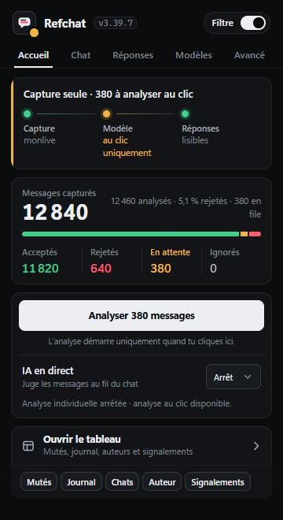
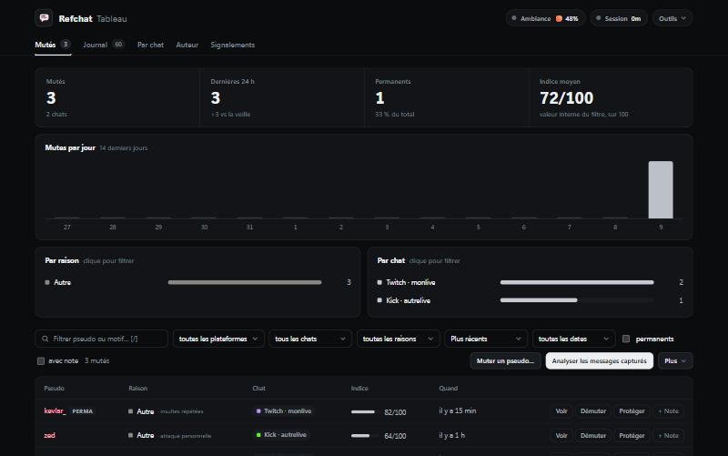

# Refchat

Extension Chrome / Brave / Edge (Manifest V3) qui filtre les chats **Twitch** et **Kick**.

Refchat lit le chat du live que tu regardes, masque les auteurs toxiques et peut mettre le chat en pause quand l'ambiance dérape. Il fonctionne **sans compte ni clé API** (analyse locale), ou avec le modèle d'IA de ton choix.

<p>
  
  
</p>

## Installation

1. Clone ou télécharge ce dépôt.
2. Ouvre `chrome://extensions` (ou `brave://extensions`).
3. Active le **Mode développeur**.
4. Clique sur **Charger l'extension non empaquetée** et choisis le dossier du dépôt.

## Prise en main

Ouvre un live Twitch ou Kick, puis le popup de l'extension. Il a cinq onglets :

| Onglet | À quoi il sert |
| --- | --- |
| **Accueil** | L'état du filtre, les compteurs, le bouton **Analyser** et l'accès au tableau. |
| **Chat** | Ce qui est masqué à l'écran, la pause automatique, les mots bannis, muter ou protéger un pseudo. |
| **Réponses** | Brouillons et réponses automatiques rédigés par Grok (compte SuperGrok). |
| **Modèles** | Le modèle qui juge le chat et les clés API. |
| **Avancé** | Synchronisation avec ton serveur et relais local, tous deux optionnels. |

Le **tableau** (bouton « Ouvrir le tableau ») regroupe les mutés, le journal des messages, les dossiers par auteur et les signalements.

## Choisir un modèle

Dans l'onglet **Modèles**, une seule de ces options suffit :

- **Aucune** : analyse locale par mots bannis et dictionnaire d'insultes (`keywords.js`).
- **Google AI Studio** (gratuit) : clé à créer sur [aistudio.google.com/apikey](https://aistudio.google.com/apikey).
- **Z.ai**, **OpenCode Go** ou **xAI** : colle la clé du fournisseur.
- **API compatible OpenAI** : OpenRouter, Groq, ou Ollama en local (URL, nom du modèle, clé facultative).
- **Compte SuperGrok** : connexion OAuth, sans clé à copier.

## Confidentialité

- Les mutés, la whitelist, le journal et les clés API restent dans le navigateur (`chrome.storage`).
- Les messages ne partent que vers le modèle que tu as choisi. En mode local, rien ne sort.
- La synchronisation (`sync-server/`) est optionnelle et auto-hébergée. Les clés API et jetons OAuth sont exclus des envois (`cloud.js`).
- L'archive disque (`archive-server/`) est optionnelle et écrit en local, dans `~/RefchatArchive`.

## Développement

```bash
npm test
```

```bash
npm run check
```

Pas de build : le dossier se charge tel quel. Les fichiers principaux :

- `content.js`, `content.css` : lecture et masquage du chat dans la page.
- `background.js` : service worker, file d'analyse, appels aux modèles.
- `popup.*`, `board.*`, `queue.*`, `theme.css` : interface.
- `keywords.js`, `regex-rules.js` : analyse locale.
- `tests/` : contrôles `check-*.js`, lancés par `npm test`.

## Licence

[MIT](LICENSE)
